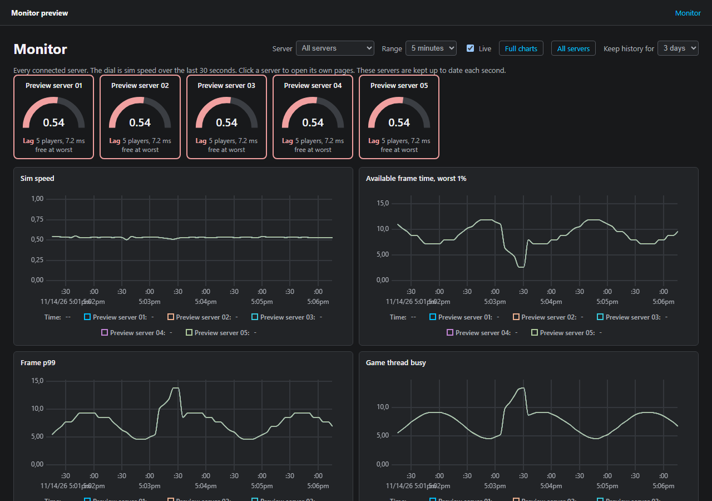

# All servers view

The All servers view shows every connected server on one page: a gauge for each, and charts with a line for each.

*Five made-up preview servers. Each gauge shows sim speed, with the players and the free frame time under it. All five have a red ring and the word Lag, because an incident is open on each. Below are charts with one line per server. The preview gives every server the same data, so here the lines lie on top of each other.*

## Open it

On the Monitor page in Quasar, open the server list at the top and pick **All servers**. It is the first entry.

The tabs are hidden in this view, because they belong to one server. Click a gauge, or pick a server in the list, to go back to that server's own pages.

The **Servers** tab on a single server's page still works as before. It shows all servers in one table.

## The gauges

Each server has a gauge card:

- **The dial** shows the average sim speed over the last 30 seconds.
- **A red ring and the word "Lag"** mean an incident is open on that server.
- **Under the dial**: the players online and the free frame time in the worst 1% of frames, for example "14 players, 2.3 ms free at worst".
- **"No data"** means nothing has arrived from that server yet. The card says why, for example "Nothing collected yet".

Click a card to open that server.

Servers in a cluster are grouped under the cluster's name.

## The charts

Below the gauges are 12 charts. Each has one line per server:

| Chart | Shows |
|---|---|
| Sim speed | How fast each game runs |
| Available frame time, worst 1% | Free time left in the slowest 1% of frames |
| Frame p99 | The frame time that 99% of frames stay under |
| Game thread busy | How much of each frame the game thread works |
| Worker time, from background totals | An estimate of worker thread time |
| Players online | Players on each server |
| Server ping | Average player ping |
| Memory | Memory used by each server |
| Garbage collections, gen 2 | Full garbage collections |
| Network sent | Data sent to players |
| RPCs from clients | Network requests from players |
| PCU | Total PCU on each server |

- Click a server's name under a chart to hide or show its line.
- Lines 1 to 8 have their own colours. After the eighth server, the colours repeat as dashed lines, then as dotted lines.
- The charts use the **Range** you picked at the top.

## How fresh it is

| Servers | Gauges | Charts refresh |
|---|---|---|
| 1 to 5 | Kept up to date each second | Every 5 seconds |
| More than 5 | Up to 30 seconds old | Every 30 seconds |

With more than 5 servers, keeping each one fresh would multiply the work for one browser tab, so the page uses Quasar's normal 30-second collection.

## What it costs

Nothing on the game servers. The view reads only Quasar's own history. It asks no server for anything new, and it does nothing on any game thread. With 5 or fewer servers it asks for the same one-second updates that a single server's page asks for.

## With one server

The view works with one server, but that server's own pages show more. The page says so and suggests picking the server in the list.
