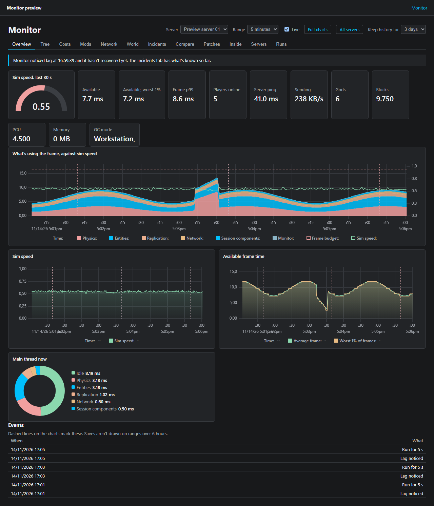

# Monitor

Monitor shows what slows down a Space Engineers dedicated server.

It measures the server while the server runs, and it keeps working during the worst lag. It tells you which grids, blocks, scripts, mods and players cost the most time.

*The Overview tab in Quasar. The top row shows sim speed, the free time in each frame, frame times and players. The charts below show what uses the frame over time. All data in this picture is made up.*

## The two parts

| Part | Where it runs | What it does |
|---|---|---|
| Magnetar plugin | On each server that uses the Magnetar plugin loader | Measures the server. Answers chat commands. Notices lag. |
| Quasar plugin | In the Quasar server manager | Keeps history. Draws charts. Opens incidents. Sends Discord alerts. Shows all servers on one page. |

You can use the Magnetar plugin alone. Then all chat commands work, and the server keeps about one hour of history in memory. With Quasar you also get charts, history for up to 7 days, incidents and alerts.

## Status

Pre-release. Both parts passed tests on test servers. They have not yet run on a live server with real players.

A Torch build exists as source code, but it is not supported. Quasar and Magnetar are the supported platforms.

## Pages in this wiki

| Page | Read it when you want to |
|---|---|
| [Install](Install) | Install Monitor in Quasar and on your Magnetar servers. |
| [Quick start](Quick-start) | Find out what is slow in five minutes. |
| [Commands](Commands) | See every chat command, with examples of the replies. |
| [Reading the pages](Reading-the-pages) | Understand each tab of the Monitor page in Quasar. |
| [Lag alerts and incidents](Lag-alerts-and-incidents) | Learn how Monitor notices lag, and what it keeps as evidence. |
| [Join hitch](Join-hitch) | Learn why a long frame after a player joins is not an alert. |
| [Thread tracking](Thread-tracking) | Learn what Main, Worker and Mixed mean. |
| [All servers view](All-servers-view) | Watch every server on one page. |
| [Settings](Settings) | Change what counts as lag, what players can run, and how much history to keep. |
| [API](API) | Use Monitor's data from your own plugin. |
| [Troubleshooting](Troubleshooting) | Fix a problem. |
| [FAQ](FAQ) | Find short answers to common questions. |
| [Glossary](Glossary) | Look up a word. |

## Links

- Source code: https://github.com/buttheadbob/Monitor
- Issues: https://github.com/buttheadbob/Monitor/issues
- License: MIT
