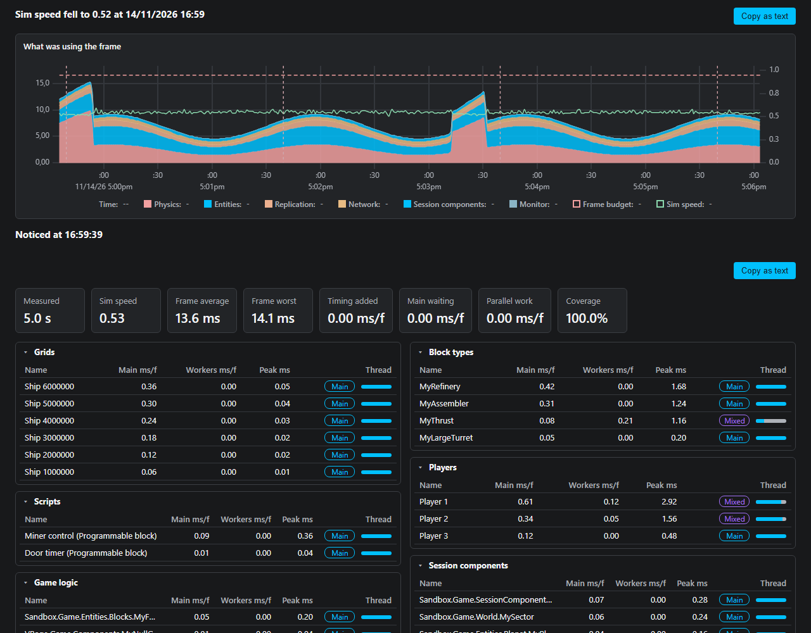

# Lag alerts and incidents

Monitor watches for lag by itself, measures it, and keeps the evidence. A problem at night can still be looked at in the morning.

## How Monitor decides that the server lags

Monitor checks once each second. It looks only at the game thread: sim speed and frame times. Worker threads are recorded and shown, but they never start an alert. See [Thread tracking](Thread-tracking).

Monitor starts a **lag trip** in three cases:

| Case | Default |
|---|---|
| Sim speed stays low for several seconds in a row | Below 0.90 for 5 seconds |
| Frame p95 stays high for those seconds | Off |
| One frame takes very long (a spike) | More than 1000 ms |

Monitor does **not** start a trip:

- in the first 30 seconds after the world is ready;
- while the server is paused;
- while a run is going, because a run's own timing is not lag;
- for a spike in the 2 seconds after a world save, because a save stops the game for a short time;
- for a spike in the grace window after a player spawns. See [Join hitch](Join-hitch).

After a trip, no new trip can start for 15 minutes. This is the **cooldown**.

You can change all of these numbers. See [Settings](Settings#lag-settings).

## What happens on a trip

1. Monitor marks the time on the charts with **Lag noticed**.
2. The server log gets a line, for example "Monitor noticed lag: SimSpeed."
3. Online admins get a chat message: "Monitor noticed lag, and is gathering the evidence."
4. For slow sim speed or slow frames, Monitor starts a run of 5 seconds. A spike gets no run, because it is over before a run could start.
5. Monitor keeps the evidence: the 20 slowest frames from the 30 seconds before the trip, the slowest single calls, and the run.
6. Admins get a second message with what the evidence shows.
7. Quasar opens an incident, and posts to Discord if you set a webhook.

A triggered run is like `!monitor diagnose`. Physics clusters are not timed in a triggered run unless you turn on **Time physics clusters**, because timing them changes physics scheduling when nobody is watching.

## Incidents

*An open incident, with made-up data. The title says what set it off. The chart shows what used the frame around it. Below is the run Monitor started when it noticed the lag, with its lists as panels.*

Incidents are on the **Incidents** tab of the Monitor page in Quasar.

- An incident opens at the trip.
- Its title says what set it off, for example "Sim speed fell to 0.62", "Frames reached 31.5 ms" or "One frame took 2140 ms".
- It closes after 60 healthy seconds in a row.
- If the lag lasts longer than the cooldown, Monitor trips again, and the new evidence joins the same incident.
- A server restart closes the incident.
- The list shows when it started, how long it lasted, the lowest sim speed and the worst frame.
- An open incident shows what looked unusual for this server, and a chart of the 5 minutes before and after.

### How to use an incident

1. Look at **Worst frames just before**. If one part took most of a frame, that part is the cause.
2. Look at the run's lists. Start with the top grids and the top mods and plugins.
3. Look at **Slowest single calls**. A single slow call points at one block, script or mod.
4. If nothing stands out, start a longer run on the **Runs** tab while the lag goes on.

## Discord alerts

Monitor can post to a Discord channel through a webhook. You do not need a bot.

| Post | When |
|---|---|
| Lag on a server, and what looked unusual | An incident opens |
| What caused it: top grids with owners and factions, mods, scripts, session components and slow calls | The evidence arrives |
| The server recovered, how long the lag lasted, and how bad it was | The incident closes |

To set it up:

1. In Discord, open the channel's settings, then **Integrations**, then **Webhooks**, and create a webhook. Copy its URL.
2. In Quasar, open the Monitor page, the **Incidents** tab, then **Discord alerts**.
3. Paste the URL. Tick **For all servers** to use it for every server that has no webhook of its own.
4. Click **Send a test**.

Good to know:

- Only Discord webhook addresses are accepted.
- Mentions are off. A grid called `@everyone` cannot ping anyone.
- The webhook address is a secret. Monitor never shows it on a page and never writes it to a log.
- Commands cannot be sent through a webhook. Use your bot or Quasar's chat page to run commands.
- Quasar has its own sim speed alerts. If both use the same channel, one lag event gives two messages. Give Monitor its own channel.
- You need the **CanManageDiscord** permission to set the webhook.

## Baselines

Quasar learns what is normal for each server, for each hour of the day.

- A baseline needs 90 minutes of data for that hour, over at least two days, before it says anything.
- Something is **unusual** when its last 5 minutes are more than a quarter above that hour's usual high. It must also be at least 1 ms above normal.
- The Overview tab shows what is unusual now. Each incident records what was unusual when it began.

## Turning it off

- For one server until it restarts: `!monitor trigger off`.
- For all servers: untick **Watch for lag** on the Incidents tab.
- Only the admin chat messages: untick **Tell admins in the game**.
