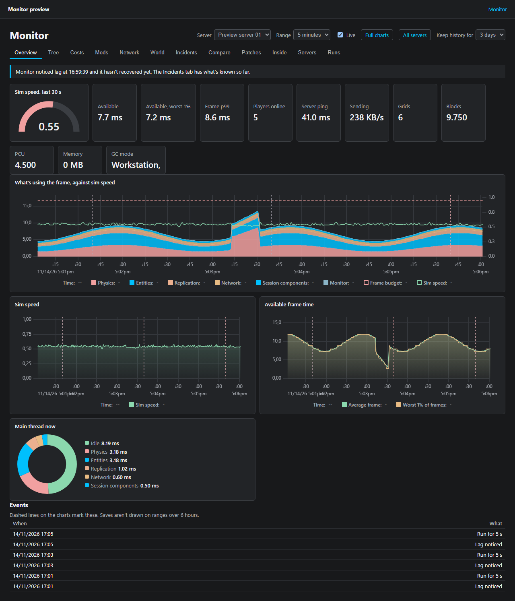
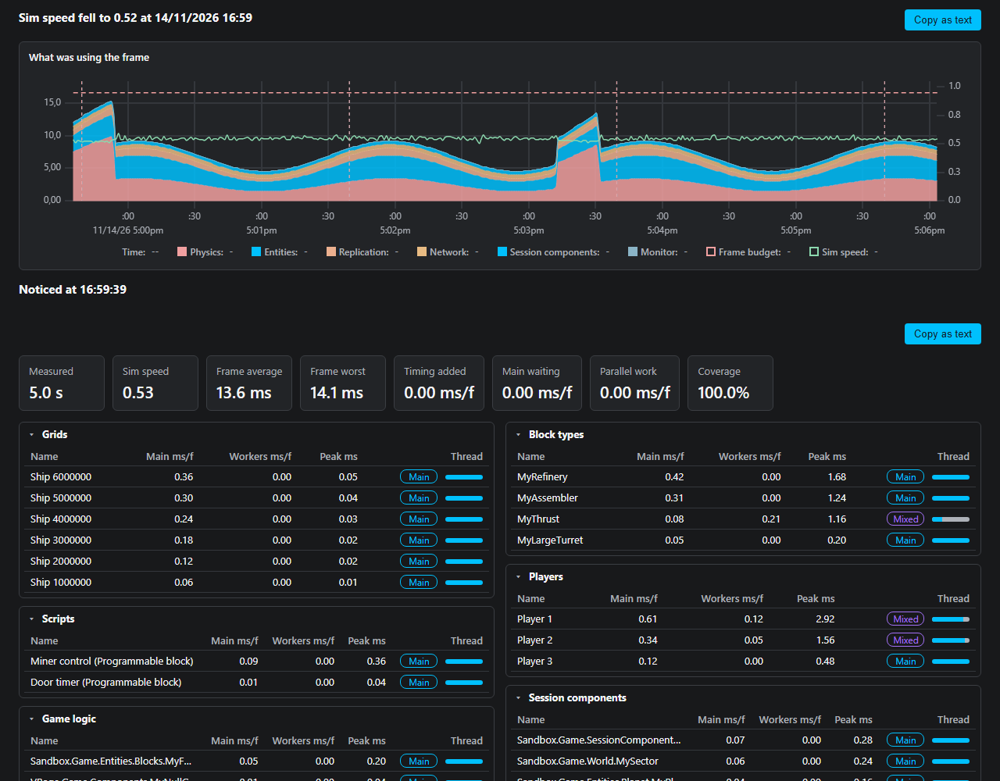
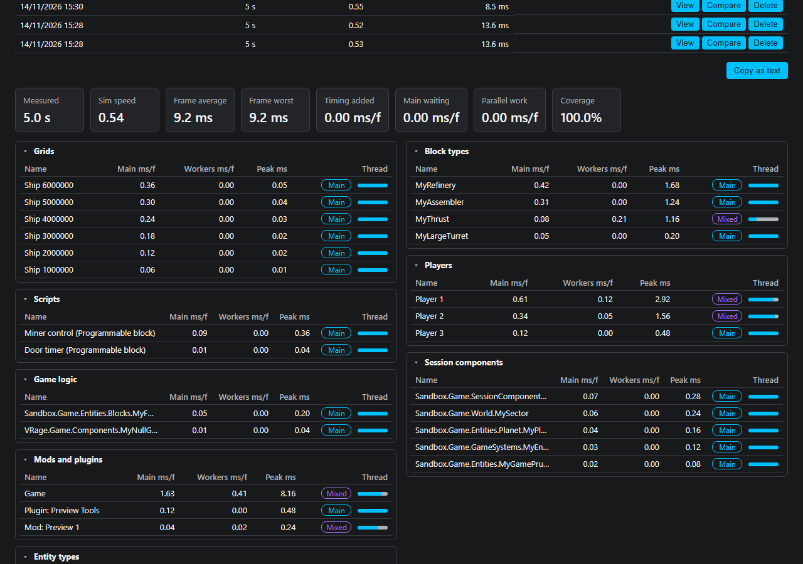

# Reading the pages

Quasar has a **Monitor** page in its menu. You need the **CanView** permission to open it.

All pictures on this page come from Monitor's preview host with made-up data.

## The controls at the top

| Control | What it does |
|---|---|
| Server | Picks the server. **All servers** at the top of the list shows every server on one page. See [All servers view](All-servers-view). |
| Range | How far back the charts go: 5 minutes, 1 hour, 6 hours, 24 hours, 3 days or 7 days. You only see ranges that fit in the history you keep. |
| Live | When on, the charts move with new data. Turn it off to hold the charts still while you study them. |
| Full charts | Opens every chart for this server, with heatmaps and treemaps, in a window of its own. |
| All servers | (With more than one server) opens every server together in a window of its own. |
| Keep history for | (With the CanEditConfigs permission) how many days of history Quasar keeps, from 1 to 7. Older history is deleted. |

Below the controls are the tabs. Tabs that read history use the range you picked.

## Overview

*The Overview tab. At the top: a sim speed gauge and tiles with free frame time, frame p99, players, ping, data sent, grids, blocks, PCU, memory and GC mode. Below: what uses the frame against sim speed, sim speed, free frame time, what the game thread is doing now, and the latest events. A notice at the top says lag is going on.*

The Overview tab is the place to start. It shows:

- **A gauge and tiles**: sim speed over the last 30 seconds, free frame time (on average and in the worst 1% of frames), frame p99, players online, server ping, data sent, grids, blocks, PCU, memory and garbage collection mode.
- **What's using the frame, against sim speed**: the parts of the frame as coloured areas, with sim speed as a line. When an area grows and sim speed falls, that part is the problem.
- **Sim speed** and **Available frame time** over the range.
- **Main thread now**: what the game thread spends each frame on, and how much is idle.
- **Unusual for this hour**: a notice that lists parts which cost more than usual for this hour of the day. See [Lag alerts and incidents](Lag-alerts-and-incidents#baselines).
- **Thread changes**: things that moved between the game thread and worker threads. See [Thread tracking](Thread-tracking#thread-changes).
- **Events**: the latest markers, such as saves, restarts, lag trips, join hitches and mod changes.

### Chart markers

Dashed lines on the charts mark events:

| Marker | Meaning |
|---|---|
| Lag noticed | A lag trip. |
| World saved | A save ended. It shows how long the save took. Saves are not drawn on ranges over 6 hours. |
| Server started | The server restarted. |
| Plugin or mod changed | A plugin or mod was added, removed or updated. |
| Run, Detail set to | A run started, or detail changed. Runs make frames a little slower, so the marker explains the bump. |
| Join hitch | A long frame after a player spawned. It has its own colour. |
| Thread change | Something moved between the game thread and worker threads. It has its own colour. |

## Tree

Where frame time went over the range, as a tree. Click a part to open it.

| Column | Meaning |
|---|---|
| Total ms/f | Time in this part, including the parts inside it. |
| Self ms/f | Time left after the parts inside it. A large Self means time that the parts below do not explain. |
| Share of frame | Total as a share of the frame. |
| Thread | All of the tree is game thread time. This column shows where the game thread waits for other threads: "Main, waits on workers" for Task wait and the two Parallel parts, and "Main, waits on physics threads" for the physics Step. |

## Costs

Any background list: grids, block types, blocks, players, factions, scripts, session components, game logic, callbacks, entity types, RPCs and mods.

- A donut chart shows the shares now.
- A line chart shows the top 6 over the range.
- A table lists the rows, with Main, Workers, Peak and the **Thread** column.

These are background numbers. They are good for trends. To find the cause of lag, use a run.

A list holds each background total's top 20. A dash means that row was not in the top of that stretch. It does not mean the row cost nothing.

## Mods

Time by whose code it is: each mod, each plugin, and the game. Open a row to see where that mod or plugin spends its time. You can send a part to the **Inside** tab to look inside it.

## Network

- **Sent and received** in KB/s, and **What's being sent** by kind (state sync, events, replication, other).
- **RPCs from clients** and **RPCs sent**, with the costliest shown over time.
- **Players now**: Down KB/s, Up KB/s, RPCs/s, Ping and Queued KB for each player.

Sim speed can read 1.00 while players rubberband. That usually shows here: a queue that keeps growing means a player cannot take what the server sends. EOS does not report queued data, so EOS players always show 0 there.

## World

- **Players online**, **Who was online**, **Online members by faction** and **Blocks by faction**.
- **Total blocks** (split into active and concealed blocks), **PCU** and **Server ping**. Concealed grids are grids that a concealment plugin has stopped, so they cost almost nothing.
- **Costing time while offline**: owners who are not online, but whose grids still cost time.
- **Capacity**: how frame time moved with the number of players, over all the history kept. This reads many files, so it runs only when you ask.

## Incidents

*An open incident. At the top, what set it off and a chart of what used the frame around it. Below, the run Monitor started when it noticed the lag, with its lists as panels.*

Every lag event with its evidence, and the lag settings. See [Lag alerts and incidents](Lag-alerts-and-incidents) and [Settings](Settings).

## Compare

Two stretches of history side by side, for example before and after a restart or a mod change. Pick an event to fill in the time before and after it.

These are background numbers. Use them for trends, and use a run to settle a cause.

## Patches

Which other plugins change the game's own methods, with the plugin names, and how many prefixes, postfixes and transpilers each method has.

With the CanControlServers permission you can start an **audit**. An audit measures what those changes cost by splitting each call into plugin prefixes, the original method and plugin postfixes. A method with several plugins shows their time together, because Monitor cannot tell one plugin's prefix from another's.

**Calls Monitor can't time** lists calls that are gone from methods another plugin rewrote. What runs there reads low or empty on every chart and run. The server is not affected.

## Inside

Looks inside a method by timing what it calls. It works the same way as [`!monitor drill`](Commands#monitor-drill-name). You need the CanControlServers permission.

This rebuilds the method while the server runs, so it takes a moment on the game thread. It comes out by itself, and it stops early if the timing costs too much.

## Servers

All connected servers in one table, up to 30 seconds old. Pick a server above for its own live charts. For charts of every server, use **All servers** in the server list.

## Runs

*A finished run. Each list is a panel in one of two columns. Click a panel's heading to open or close it.*

- **Start a run** (with the CanControlServers permission). A run times every call for its length, then puts detail back as it was. This is the accurate way to find a lag cause.
- **Saved runs**: every run, also the ones from chat commands and from lag trips. Results stay for as long as history is kept.
- **Compare**: pick a second run to compare with.
- **Copy as text**: copies the result for a forum post or a ticket. Each row starts with `M`, `W` or `M+W`.

The lists sit in two columns of panels, and in one column on a narrow screen. Your browser remembers which panels are open. "Mods and plugins" always sits above "Entity types". Long names end with "…". Point at a name to see all of it.

## The Entities page

Monitor also adds to Quasar's own **Entities** page:

- An **ms/f** column for each grid, from the latest background total.
- A **Profile** button that times one grid for 10 seconds (with the CanControlServers permission).
