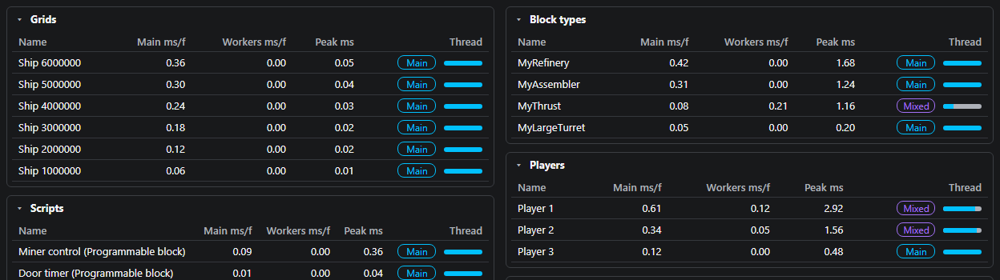

# Thread tracking

The game runs some work on the **game thread** and some on **worker threads**. Monitor shows where the time of each thing went, because the two cost the server in different ways.

## Why it matters

- **Game thread time** slows the frame directly. If a grid costs 3 ms on the game thread, every frame is 3 ms longer.
- **Worker time** runs at the same time on other CPU cores. It slows the frame only when the game thread has to wait for the workers to finish.

So 3 ms of worker time can cost nothing, while 3 ms of game thread time always costs 3 ms. To find what slows the server, look at game thread time first.

## Main, Worker or Mixed

Every row in every list has a thread label:

| Label | In chat | Meaning |
|---|---|---|
| Main | `M` | Almost all of its time is on the game thread. |
| Worker | `W` | Almost all of its time is on worker threads. |
| Mixed | `M+W` | It uses both. Each side has at least 5% of its time. |
| (empty) | `-` | No time was recorded for it. |

A side with less than 5% of the time does not count, so a few stray calls do not make a row Mixed.

Examples:

| Main ms/f | Work ms/f | Label | Why |
|---|---|---|---|
| 1.20 | 0.03 | Main | Work is 2.4% of the total, under 5% |
| 0.01 | 0.71 | Worker | Main is 1.4% of the total |
| 0.05 | 0.91 | Mixed | Main is 5.2% of the total |
| 0.00 | 0.00 | (empty) | Nothing recorded |

Physics clusters have no label. A cluster is timed with all physics threads for itself, so a label means nothing there.

## Where you see it

### In chat

The `On` column, on every list:

```text
> `Main  Work  Peak   On` Name
> `1.84  0.62  6.10  M+W` Iron Hauler
> `1.20  0.03  3.40    M` Outpost Kappa
```

### In Quasar

A **Thread** column on every list. It shows the label and a small bar. The first part of the bar is game thread time. The rest, in grey, is worker time.



*Lists from a run, with made-up data. Most rows are Main. "MyThrust" and two players are Mixed: the grey part of their bars is worker time.*

### On the Tree tab

All of the tree is game thread time. The **Thread** column shows where the game thread waits for other threads:

- "Main, waits on workers" for **Task wait** and the two **Parallel** parts.
- "Main, waits on physics threads" for the physics **Step**.

### In runs

Every run reports two facts:

| Fact | Meaning |
|---|---|
| Main waiting | How long the game thread waited for worker threads, per frame. This is how worker time slows a frame. It can read a little high, because it includes handing out the work. |
| Parallel work | Time on worker threads in the game's parallel updates, added up over all workers, per frame. It is not frame time. |

If **Main waiting** is large, the workers are the bottleneck. Look for rows labelled Worker or Mixed with high Work time. If it is small, worker time is not slowing the server, however large **Parallel work** is.

**Copy as text** on a run starts each row with `M`, `W` or `M+W`.

## Thread changes

Sometimes something moves between threads. For example, a grid's update can stop running on worker threads and run on the game thread instead. That can make the server slower without the grid doing more work.

- Monitor checks every grid, block type, block, entity type, session component, game logic, callback, script, RPC, mod and mod part in each background total.
- A change counts only when the new label stays for two background totals in a row (about one minute). A row near the 5% line does not jump back and forth.
- Rows with less than 1 microsecond per frame are ignored. There is too little time to decide.
- Each thread change is a marker on the charts in its own colour.
- The Overview tab lists them under **Thread changes**, for example "Grid Miner moved from worker threads to the game thread".
- Each background total lists up to 40 changes, the costliest first. If there are more, you see "N more thread changes not listed".
- A thread change never starts an alert, a run or an incident. Only game thread time can do that.
- A new name can show as `#` and a number, for example "Grid #81234". The real name appears when that grid shows up in a normal list. After Quasar restarts, old thread changes can still show the number.

## Good to know

- Labels come from measured time, not from what the game intends. A block type that normally runs on workers shows as Main if the game ran it on the game thread in that measurement.
- The APIs give the label as `MonitorThread` and report `ThreadJump` events. See [API](API).
